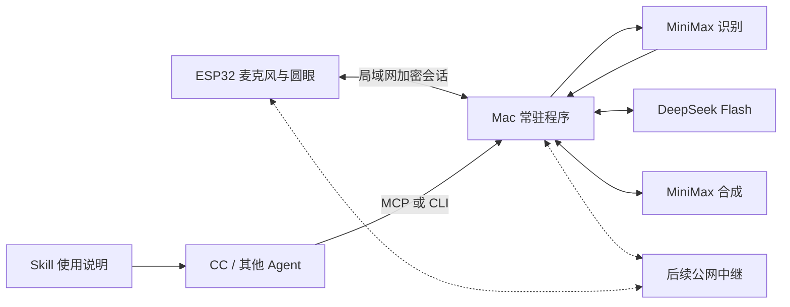

# Round Eyes Companion：电脑 Agent 与 ESP32 表情终端

日期：2026-10-23（Asia/Shanghai）
状态：用户已于2026-10-23确认本设计并要求继续；实施计划编写中。本文不代表程序、接口或新固件已经实现。

## 1. 目标与已确认的意图

用户希望用自己的电脑程序和 API Key 驱动现有 ESP32 圆屏：一句话说完后，模型结合上下文理解意思，先给出合适的眼神反应，再回答。未来其他人安装程序或 Skill，经配对和授权后，也能控制自己或被授权的设备；先支持同一局域网，后扩展跨网。

已确认：

- 首版按完整句子反馈，不要求尚未说完就理解并改变表情。
- DeepSeek V4.1 Flash 负责语义判断和回答。
- 语音识别与合成默认使用 MiniMax；ASR/TTS 分别做成可替换模块，预留阿里云 DashScope 接入与独立切换配置。
- 当前固定黑圆脸、白眼、25 眼型、21 情绪与连续动画保留，网络只发送目标和事件，不传动画每一帧。
- 先做 Mac 程序、局域网配对、设备接口和 MCP/CLI；公网中继后续实现。

首版默认：用户继续使用开发板麦克风；电脑负责云端 API 编排。正式音色与系统音色 voice_id 在设置中选择，不克隆任何人的声音。电脑程序本地运行，DeepSeek/MiniMax 推理仍在各自云端。

## 2. 当前基线与可复用部分

硬件：ESP32-S3 N16R8、8MB OPI PSRAM、16MB Flash、GC9A01 240×240。麦克风输入16kHz单声道，现有编解码器输出24kHz。引脚与接线保持现有已验证配置。

现有固件是小智 v1.9.4 的本地扩展，已有唤醒、音频任务、Wi-Fi、MQTT、小智绑定与独立 `character/` 动画模块。最新圆眼固件 SHA256：

`a3f06cd723d384316bda9e55f46df0113434a417ecb07dc0fa356ef73e467ba2`

其正常圆眼显示已获用户确认，10轮自动语音和10分钟运行通过；板端喇叭仍等待 MAX98357A 模块，断网/升级提示的实物布局尚待单独检查。

新工作不把小智云 MCP 当作主要控制通道。电脑直接管理设备与模型；现有小智模式作为可选择的兼容模式保留其配置。Companion 模式下音频只进入用户选定的链路，断连不自动转送到另一家服务。

## 3. 架构选择与边界

比较过三条路线：

| 路线 | 收益 | 代价与限制 | 决定 |
| --- | --- | --- | --- |
| 小智云增加表情工具 | 改动少，复用现有语音 | 每轮是否先调用工具受第三方编排影响；安装、授权与分发难独立控制 | 不作为产品主链路 |
| 常驻电脑程序直接调用 API，同时提供 MCP/CLI | 时序、凭据、设备权限可控；其他 Agent 可复用 | 需要实现音频和配对通道 | 首版采用 |
| 每句都通过完整 CC/其他 CLI Agent | 可复用已有工具和 Skills | 进程启动、工具循环与长任务延迟波动；还需要设备通信工具 | 作为接入方，不作为默认语音热路径 |



设备负责采集/播放、鉴权、控制权、参数校验与本地动画。电脑负责配对发现、API 调用、对话状态、连接与凭据管理。模型选择语义反应，不能绕过设备权限或执行任意设备代码。

## 4. 首版范围与阶段

首版必须形成可安装、可使用的闭环，不能用网页假设备演示代替硬件交付：

1. Mac 常驻程序与本机设置界面，发现/配对/选择设备，配置服务商和音色。
2. ESP32 局域网加密控制及音频会话，保持原圆眼渲染。
3. DeepSeek 文字输入语义反应，CLI 与 stdio MCP 工具；用于先验证控制链路。
4. 开发板麦克风→MiniMax ASR→语义反应→DeepSeek 回复→MiniMax TTS→播放的完整链路。
5. Mac 本机安装包、配置与 Skill/MCP 接入说明、可核查的验证记录。

后续范围：公网中继、跨网授权邀请、Windows 包、远程音频。首版为这些保留协议版本、设备身份和传输适配器，不实现或开放一个未经部署验证的公网控制入口。

## 5. 服务商与音频格式（官方文档核对）

### DeepSeek

- 接口模型名 `deepseek-flash`，官方当前映射 DeepSeek-V4.1-Flash-1017。
- 使用非思考模式处理低延迟语义反应；支持 JSON 输出和工具调用。
- 已核对的聊天接口是文字/图像与工具能力；未确认其提供可替代本项目 ASR/TTS 的独立语音接口，因此首版不依赖该假设。
- Provider 层隔离模型名、base URL、超时和调用格式；不把供应商字段放入设备协议。

### MiniMax ASR

- `POST https://api.minimax.cn/v1/speech_to_text`，模型 `asr-1.0`，multipart 上传音频文件。
- 支持识别结果 SSE 增量返回；这不等于接口接受无限时长、边录边上传的双向音频流。
- 官方文件上限500秒/50MB，支持 WAV 等容器，不接受无容器裸PCM。
- 首版电脑将每轮已结束的16kHz单声道16位PCM封装WAV后上传；应用自身限定每轮最多30秒，超限明确结束/提示，不静默截断后当完整句处理。
- 空识别不启动模型；识别失败或超时给出可恢复状态，不猜测用户意思。

### MiniMax TTS

- WebSocket：`wss://api.minimax.cn/ws/v1/t2a_v2`。
- 首版候选模型 `speech-2.8-turbo`；以实际账号可用性与试听结果验证，模型/系统音色可配置。
- 按协议等待 `task_started` 后发送 `task_continue`，按句流式返回音频。
- 请求24kHz、单声道PCM，匹配当前板端输出。解析供应商音频编码后再交给设备，不把JSON/十六进制字符串当PCM播放。
- 流式的“收到了音频”与“设备开始播放”分开计时；后者驱动现有说话包络。

### DashScope 切换接口（用户追加要求）

- ASR 与 TTS 分别选择 provider，不与 DeepSeek 的语义模型绑定；允许 MiniMax ASR + DashScope TTS 等组合。
- 阿里服务 base URL 由用户在本机配置，仓库示例为 `https://your-deployment.example.com/api/v1`，作为独立服务配置，不附带任何密钥。
- 此地址支持的协议、可用模型、ASR/TTS 权限尚未验证。不能仅根据 base URL 推断它支持文件识别、流式识别或语音合成；不直接套用 MiniMax 路径，也不把常见 DashScope 公共接口与该专属地址混用。
- 保留 provider 注册、capability 检测、模型/音色/区域/endpoint 配置。DashScope 实际适配以官方协议和该部署能力核验为前提；未验证时显示“待验证”，没有适配时明确显示“尚未接入”，不能伪装成可用。
- 切换时取消当前轮次，清空旧 provider 的待播音频，再将新配置用于下一轮；不混接一轮的供应商返回，不在故障时自动切到另一个收费服务。
- DashScope 凭据使用独立 Keychain account；访问地址按明确配置绑定，不跨供应商附带 Authorization，不跟随携带凭据的跨域重定向。设置页面仅显示已配置状态。

语音与推理使用独立凭据；拥有 DeepSeek Key 不代表同时拥有 MiniMax 接口权限。实现与联调时在本机设置里配置，不在聊天、仓库、Skill 或固件中填写真实 Key。

## 6. 语义与表情时序

首版采用可验证的两阶段编排，避免仅靠提示词期待模型“自愿先调用工具”：

1. 设备完成一轮唤醒/采集，发送 `utterance.end`；VAD结束到ASR完成期间显示聆听/等待动作。
2. ASR最终文本及近期上下文交给一个短语义请求，只返回受限表情决策。
3. 电脑校验决策，发给当前设备并等待已应用确认；同一轮后到的旧结果不能覆盖新轮次。
4. 表情已应用后生成对话回复；按句交给TTS并播放。表情确认超时则报告设备连接问题，不能无限等待或假报“已显示”。
5. 说话包络继续来自实际播放PCM，不根据模型输出字数假装在说话。

语义请求和回复请求复用同一份有界上下文，但职责分开。首版可能每轮产生两次较短/较长的模型请求，成本与延迟都实测；后续再基于数据考虑合并流式协议，不以未验证的首字段顺序作为正确性前提。

表情决策示例（概念协议，正式Schema在实施计划中固定）：

```json
{"emotion":"relaxed","hold_ms":1600}
```

- emotion只允许现有21个情绪键；25眼型由设备编排，不要求模型发送坐标。
- hold_ms限定为300–3000ms；模型不能通过参数长时间占用设备。
- 依据上下文、否定、玩笑与对用户的回应态度选表情，而非简单镜像用户情绪。比如用户难过时优先关心，不自动作出怒眼；“我没有不开心”不能只因关键词判断成悲伤。
- 未知键、格式错误或不明确语义采用温和中性回退；不执行模型返回的URL、命令行或设备地址。
- 新一轮输入、打断、断连、租约失效均取消旧轮次请求、待播音频与表情持有。

不宣称零延迟。记录VAD结束、ASR最终文本、语义结果、设备应用、回复首token、TTS首音频、首个实际PCM播放的独立时间点。获得端到端 p50/p95 后确定体验指标。

## 7. 局域网身份、首次配对与授权

设备发布无敏感信息的mDNS服务，电脑也可手工填写局域网地址。自动发现不等于控制授权。

首版首次配对使用当前已有USB连接进行可信引导：

- 设备生成独立身份和自签名TLS证书；通过USB读取设备ID、证书公钥指纹，并在显式配对操作中交换该电脑的独立凭据。
- Mac存储证书指纹，后续HTTPS/WSS连接必须匹配该设备身份；不启用“忽略TLS校验”的通用开关。
- 初次创建控制者需要用户在设备上物理确认。沿用BOOT现有按键语义时必须避开启动断网时的Wi-Fi重置分支；不能为了配对误清除Wi-Fi/NVS。
- 仅在启动完成、设备空闲并收到USB配对请求后进入有超时的确认窗；这时BOOT点击用于确认，其他时候保留原行为。配对中或控制中的身份信息用系统关键提示展示。
- USB管理命令有专用前缀、长度上限和显式状态机，凭据不得进入串口日志。普通语音和模型指令不能触发配对。
- 首版无需实现未经评审的短码自创密码协议。后续无线首次配对采用经过验证的方案，另行设计；不直接把秘密发给尚未认证的局域网端点。

每个控制者有自己的随机凭据，可单独撤销。安装程序或复制Skill本身不会获得任意设备的权限。主人主动配对/授权后才能使用。设备凭据与模型API Key相互独立。

设备身份/凭据使用独立NVS命名空间，先核对可用容量；空间不足明确报错，不清除现有绑定来腾空间。原型不宣称能够抵抗拥有实物和刷写能力的人提取设备密钥；正式产品的安全启动/加密存储另行评估。

## 8. 设备接口与控制权

首版局域网使用设备端HTTPS/WSS服务：

- `GET /v1/info` 仅返回最小公开身份、协议版本和能力；不包含凭据、Wi-Fi配置或对话历史。
- `/v1/session` 通过加密连接完成已配对控制者鉴权，承载指令、确认、状态和有界二进制音频帧。凭据不放URL查询参数。
- 参数校验、帧大小上限、速率限制与授权在设备执行，不依赖模型守规矩。
- 区分状态只读、表情控制、语音流和主人管理权限；外部Agent入口默认只有状态/表情能力，不能通过同一个工具获得配对或凭据管理权。
- 每次设备启动有新的boot_id；每个会话有独立session_id、seq；每个语音轮次有递增turn_seq。过期、重复、旧轮次和旧启动实例的指令均不能生效。
- 指令包含command_id和设备时间域中的截止时间；握手交换设备uptime和RTT估计，不假设Mac与ESP32的墙上时钟已同步。重复指令只返回原确认，不重复执行副作用。

控制者租约：心跳5秒、失联15秒释放；同一设备同一时刻只有一个写控制者。其他程序可获只读权限或明确收到busy；强制接管由主人显式操作，模型不能自行抢占。

显示优先级：系统关键提示 > 主人显式临时手动控制 > 当前语音轮次的语义反应 > 外部Agent任务状态 > 待机。兼容小智模式与Companion模式有明确切换，避免两个后端同时下发表情或上传麦克风。

指令只改变目标状态；本地动画计时器独立运行。网络任务不能拿LVGL锁做长等待，TLS握手、供应商请求和音频IO均不能进入渲染回调。

## 9. 音频与并发资源

- 上行默认PCM16LE/16kHz/单声道，20ms一帧约640字节。下行PCM16LE/24kHz/单声道；握手协商实际能力，格式不匹配明确拒绝。
- 设备音频与网络间使用固定容量、有上限的队列；设备不保存整句音频。电脑持有本轮最多30秒PCM，约960KB，封装WAV上传ASR。
- 音频分帧有stream_id、顺序号与结束标记。队列溢出取消本轮并报告，不静默丢帧后提交错误句子；中断时清空旧音频，禁止串轮播放。
- TLS服务限制并发连接和消息大小；音频控制与大块数据分帧，避免单个大消息阻塞取消、确认与关键状态。
- 首版只允许一个活动写控制会话，先不叠加多个观察者TLS连接。采用握手超时和接入节流，控制文本与音频分别限速，不能把音频的50帧/秒误判成控制指令风暴。
- 使用现有音频任务边界；音频采集/播放任务不直接调用HTTP供应商或修改模型/UI。
- 保留已验证的61440字节RGB565眼区画布，测量新增TLS/队列内存峰值、渲染FPS和音频连续性；不以8MB PSRAM存在代替实际内存预算。
- 开发期间允许用户显式选择Mac扬声器作为TTS输出，便于功放到货前使用；不能静默更换播放位置，也不将电脑播放通过记为板端喇叭通过。

## 10. 电脑程序、CLI、MCP和Skill

建议核心采用TypeScript和固定版本Node运行时，提供统一DeviceClient、VoicePipeline和Provider接口；macOS薄启动器负责安装启动及Keychain集成。Node运行时随包提供，使用者不必先配置开发环境。最终技术依赖及版本在实施计划中锁定。

本机管理界面仅监听127.0.0.1，提供设备列表、USB配对、服务商/音色设置、模式切换、文字语义测试和连接诊断。管理接口有本机会话、Host/Origin校验与CSRF保护，不向局域网开放配置或读取密钥接口。

- API Key保存在macOS Keychain；通过原生Security接口/安全IPC访问，不把秘密放入进程命令行、日志或前端持久化存储。
- 默认不持久化原始录音和完整对话；诊断默认仅记录事件ID、耗时、长度、状态码与资源统计。录音/文本导出由用户明确开启。
- 首版每轮固定短语义请求与回复请求，不开启无限Agent循环；认证/余额失败不自动重试，限流与瞬时故障只在该轮的有界超时/重试预算内处理，费用和请求次数可查看。
- CLI提供发现、配对、状态、语义输入、表情控制和释放控制权；CLI与MCP共用鉴权/DeviceClient，不各自维护另一套协议。
- MCP首版采用stdio，仅暴露列出已授权设备、读取状态、发送受限表情/语义输入等能力。没有任意shell、固件刷写、Wi-Fi重置或读取凭据工具。
- Skill描述何时使用这些工具、如何选择反应、如何处理设备离线；实际通信由CLI/MCP完成。也可打包为安装Skill时附带设备工具的体验。
- 外部Agent已决定表情时可直接调用受限工具，不再额外调用DeepSeek重新分类。长任务事件可以驱动等待、思索、完成等状态。

本轮目标是本机可安装包及安装/卸载验证；面向其他机器的正式分发还需要签名、公证和安装验证。不能以本机开发运行成功声称已完成公众发布。

## 11. 公网扩展约束（后续）

设备和电脑都主动建立到中继的TLS连接，通过设备/控制者身份及ACL路由。无需用户配置路由器端口映射。

中继先承载命令、确认和状态；跨网完整语音作为后续能力，另测带宽、时延与隐私边界。中继不保存模型API Key，不通过广播token授权全体用户，不保留过期表情等待设备上线后执行。必须支持解绑、单控制者撤销、会话失效和设备离线状态。

本地与远程共享应用层消息和授权语义，传输通过适配器替换。首版只标记远程能力未实现，不能显示一个实际无效的“远程已启用”。

## 12. 验证与交付标准

软件与设备：

- 配对身份匹配、错误凭据/越权拒绝、撤销生效、重复/过期/旧turn指令不执行、双控制者竞争与断连释放。
- DeepSeek与MiniMax协议适配先用fixture验证；真实API在本机配置凭据后做次数/时长有界的联调，记录实际模型名与耗时，不记录Key。
- 语义用例覆盖否定、反讽、上下文指代、关心式反应、不明确输入与空ASR。模型不可用与断网不伪报已控制。
- 新轮次打断旧LLM/TTS/音频队列，验证迟到数据不能显示或播放。
- 保留原25眼型无黑缝像素测试；新增通信/音频压力下至少10轮对话、10分钟实机运行，记录刷新FPS、最长更新、堆、看门狗/重启。
- 字幕开关、角色关闭、兼容小智模式各有构建与基本回归证据；关键配网/错误/升级提示不得被远程控制覆盖。
- 安装、首次配置、登录后启动、升级保留配对、卸载行为都在Mac实际验证；完整模型/语音真实联调与板端喇叭声学验收分开记录。

交付：独立电脑源码、Skill/MCP配置、设备协议、固件源码/补丁、已验证应用镜像、可安装程序、重建与回滚说明、按项passed/failed/pending的验证记录。

当前小智基线、分区表、NVS和语音模型保留备份。刷写前读取实时OTA选择，只更新确认的应用槽；新增设置使用独立命名空间，不用清空NVS恢复默认来解决配对问题。

## 13. 已知待核实项

1. MiniMax账号是否已开通ASR及所选TTS模型/音色；真实调用延迟和费用尚未测量。
2. 本地TLS音频并发下的ESP32内部内存峰值与CPU负载；必要时先降低数据队列/连接数，不修改麦克风/屏幕接线。
3. 句末VAD阈值与端到端体验；不承诺尚未测过的“几百毫秒”。
4. 板端功放到货后的真实音频播放验收。
5. 正式安装包签名/公证所需开发者身份和分发渠道，公网中继的托管位置与账号体系；不阻塞本地核心设计，但不能声称已完成这些能力。

## 14. 来源与设计自检

已于2026-10-23读取官方页面：

- https://api-docs.deepseek.com/quick_start/pricing
- https://api-docs.deepseek.com/guides/tool_calls
- https://api-docs.deepseek.com/api/create-chat-completion
- https://platform.minimaxi.com/docs/api-reference/speech-to-text
- https://platform.minimaxi.com/docs/api-reference/speech-t2a-websocket.md
- https://platform.minimaxi.com/docs/llms.txt

本地依据：`hardware/esp32-bringup/character/`、小智 `application.cc`、`mcp_server.cc`、`protocols/mqtt_protocol.cc`、当前板型 `config.h` 与 `VERIFICATION-eyes.json`。

自检：语音/语义/设备/分发职责已分离；MiniMax文件ASR与流式输出已区分；首次信任不依赖未认证局域网；模型与设备凭据分离；CLI/MCP共用协议；旧轮次与多控制者有仲裁；保留稳定固件与回滚；局域网交付与公网/公众发布未混为完成。

下一阶段：用户评审本文后，编写实施计划并确定执行方式，再实现程序与固件。
